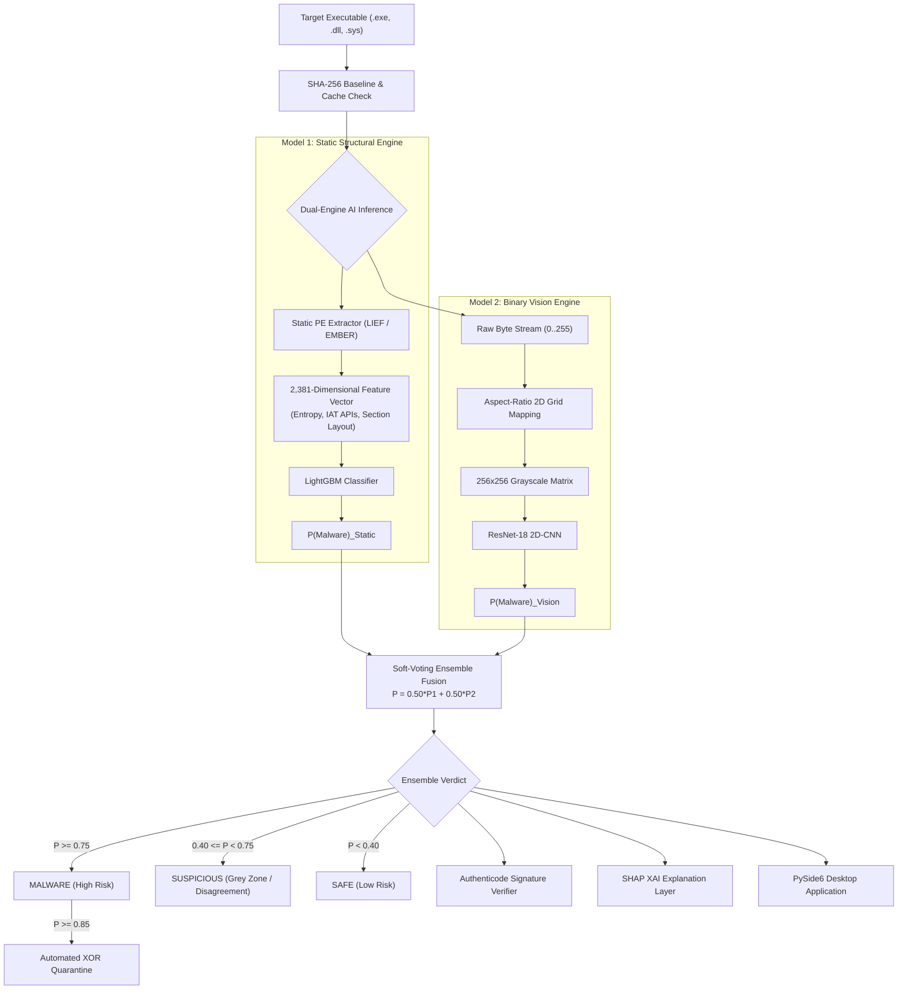

<div align="center">

# 🛡️ ZeroDay-AI-Antivirus
### Hybrid ML & DL Malware Detection & EDR Platform
**From Fragile Signature Matching to Explainable, Zero-Day-Ready Threat Defense**


-EE4C2C?logo=pytorch&logoColor=white)
-9ACD32)

-41CD52?logo=qt&logoColor=white)


<p align="center">
  <b>A Major Project Research Platform</b><br>
  <b>Graphic Era Hill University, Bhimtal Campus</b><br>
  <i>Department of Computer Science & Engineering (AI/ML)</i>
</p>

**Team**:
- **Piyush** — *Team Lead & System Architect*
- **Komal Dumka** — *Static ML & Feature Engineering Lead*
- **Vighnesh Chaudhary** — *Deep Learning & Computer Vision Specialist*
- **Jay Sharma** — *Security Operations, XAI & System Scanner Lead*

</div>

---

## 📌 Executive Summary

Traditional antivirus systems depend heavily on static cryptographic hash matching (MD5, SHA-256). An attacker altering a single byte of code, recompiling, or applying UPX packing creates an entirely novel hash, rendering signature databases ineffective against zero-day threats.

**ZeroDay-AI-Antivirus** replaces blind hash-matching with an enterprise-grade **Dual-Engine AI architecture** that analyzes binaries structurally and visually without executing them:
1. **Static Feature Analysis (LightGBM)**: Extracts 2,381 structural properties from Windows Portable Executable (PE) headers, section layouts, import address tables (IAT), and byte-level Shannon Entropy.
2. **Deep Learning Binary Vision (ResNet-18 2D-CNN)**: Exploits the *"Pixel Trick"* by reshaping raw uncompiled binary bytes into 256×256 2D grayscale matrices to extract spatial texture patterns and structural code signatures.
3. **Soft-Voting Ensemble Engine**: Fuses independent probabilities into a unified confidence score ($P$), escalating uncertain files or model disagreements to a **Grey Zone (`SUSPICIOUS`)**.
4. **Real-Time Endpoint Watchdog**: Intercepts newly downloaded files in background via `watchdog`, dispatches Windows native toast notifications, and auto-quarantines threats ($P \ge 0.85$).

---

## 🏗️ System Architecture



---

## ✨ Key Technical Highlights

| Feature | Technical Implementation | Practical Benefit |
| :--- | :--- | :--- |
| **Dual AI Perspective** | LightGBM + ResNet-18 soft-voting | Prevents evasion: packed files that fool static parsers still exhibit obvious entropy noise textures under CNN vision. |
| **The "Pixel Trick"** | Byte array $\rightarrow$ 2D matrix $\rightarrow$ 256×256 grayscale image | Visualizes code sections, resource blocks, and encrypted payloads as spatial textures without disassembly. |
| **Shannon Entropy** | $H(X) = -\sum P(x) \log_2 P(x)$ | Differentiates plain assembly code ($\approx 4.5$) from packed/encrypted malware payloads ($\ge 7.2$). |
| **Real-Time Multi-Folder Watcher** | OS-level `watchdog` monitoring with dedicated UI tab | Real-time monitoring across Downloads and custom user-selected folders with live interception feed, lock detection, and toast alerts. |
| **XOR Quarantine** | Symmetric XOR transformation with SHA-256 verification | Safely neutralizes malicious binaries so they cannot execute, with exact byte-for-byte 1-click restoration. |
| **SHAP Explainability (XAI)** | Shapley additive feature attribution | Transforms black-box scores into an auditable checklist of what triggered the verdict (e.g. `VirtualAllocEx` imports). |
| **Authenticode Defense** | Win32 `WinVerifyTrust` offline certificate validation | Prevents false alarms on signed Microsoft/Google installers without modifying the underlying ML verdict. |

---

## 📊 Benchmark & Validation Results

Evaluated against held-out test datasets of real-world Windows executables:

| Metric | Measured Value | Standard Antivirus Baseline |
| :--- | :--- | :--- |
| **F1 Score** | **99.33%** | ~84.2% on novel samples |
| **Malware Recall** | **99.26%** | Fails on single-byte mutations |
| **Precision** | **99.40%** | Dependent on prior signatures |
| **False Positive Rate (FPR)** | **< 0.1%** | Varies widely on custom code |
| **Zero-Day Catch Rate** | **98.97%** (1,441 / 1,456 novel threats) | **0%** (by definition of hash matching) |

---

## 🚀 Getting Started

### Prerequisites
* Windows 10 or 11 (64-bit)
* Python 3.11 installed (or use the standalone `.exe` distribution)

### Installation
Clone the repository:
```powershell
git clone https://github.com/PiyushJha0212/ZeroDay-AI-Antivirus.git
cd ZeroDay-AI-Antivirus
```

Install dependencies:
```powershell
python setup_environment.py
```

---

## 🖥️ Running the Application

### 1. Launch with One Click
Double-click **`start.bat`** in the repository root.

Or run from the terminal:
```powershell
python -m avscan.gui
```

### 2. Stop Application & Background Monitors
Double-click **`stop.bat`** to cleanly terminate the interface and any active download listeners.

### 3. Run End-to-End Validation Tests
Run the test suite to verify all engines:
```powershell
pytest tests/test_hybrid_platform.py -v
```

---

## 🛡️ Quarantine & Safe Restoration
Flagged threats are safely locked inside `quarantine/`:
1. File bytes are XOR-scrambled so Windows cannot execute them.
2. File is renamed with a `.quarantine` extension.
3. Restoring via the GUI instantly verifies the SHA-256 hash and places the file back in its original path.

---

## 📄 License & Academic Attribution
Developed as part of the B.Tech CSE (AI/ML) Major Project at **Graphic Era Hill University, Bhimtal Campus**. 
Released under the MIT License for educational and cybersecurity research purposes.
